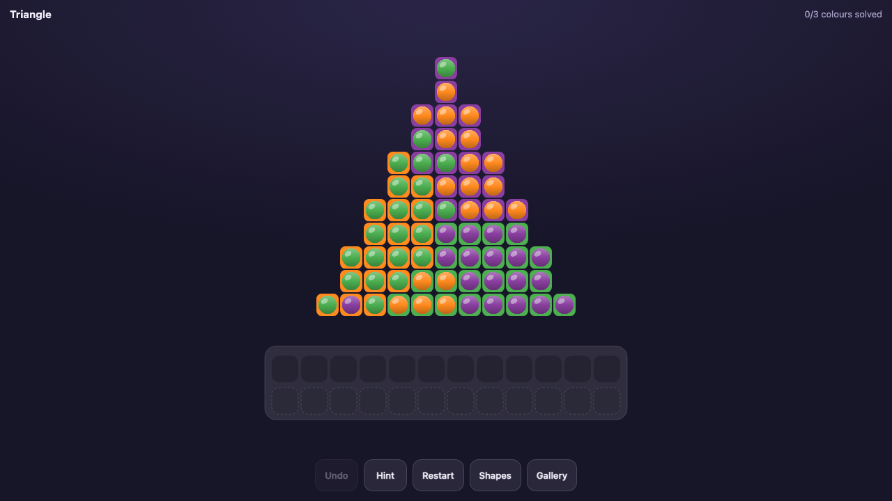
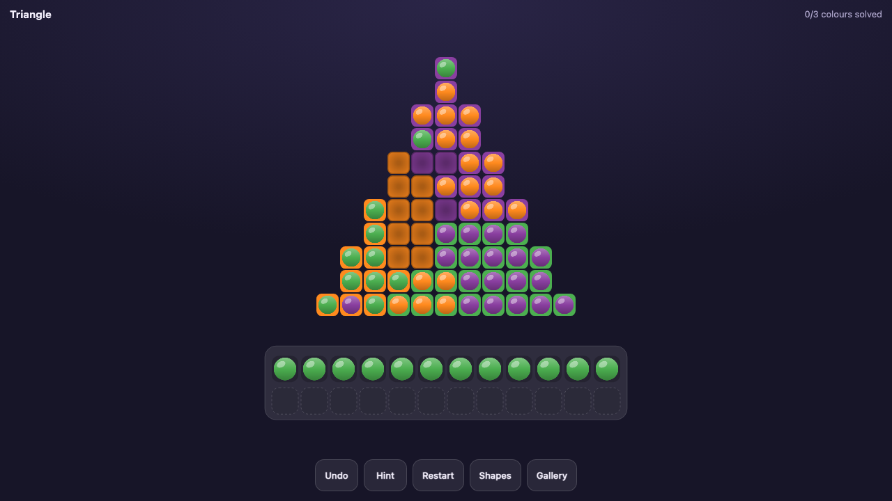
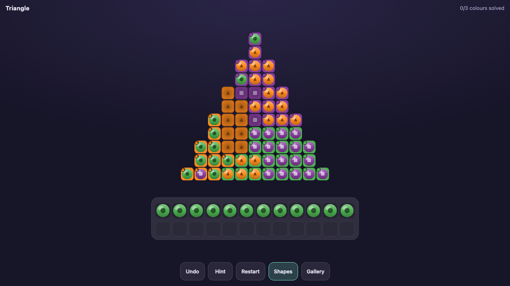

# Jewel Swap

**[Play it →](https://jewel-swap.vercel.app)**

A calm colour-permutation puzzle dressed as diamond painting — the loop from
*Jewel Coloring* (TaTa Game Technology, 10M+ installs), kept intact and stripped
of the free-to-play funnel. No ads, no timers, no energy, no purchasable shelf
slots. Undo, hints and restarts are free and unlimited.

TypeScript and Canvas 2D, **zero runtime dependencies**, installable as an
offline PWA. 105 levels, every one certified solvable by the bundled solver
before it ships — that certification is an actual test, one per level.



```bash
npm install
npm run dev        # http://localhost:5173
npm test           # 322 unit tests
npm run e2e        # 60 e2e tests across Android / iPad / desktop
npm run build      # → dist/  (81 kB, 24 kB gzipped)
```

## Getting it onto a phone or iPad

### Without deploying anything

`vite.config.ts` sets `host: true`, so `npm run dev` also serves on the LAN and
prints a Network URL — open that on any device on the same Wi-Fi.

The catch: **the service worker will not register over plain HTTP**, so this
gives you the game but not an offline install. Fine for playtesting, not for
keeping on your home screen.

### Deployed (this is the one you want)

```bash
npm run deploy          # vercel --prod
npm run deploy:preview  # throwaway preview URL first
```

First run only: `npx vercel login`, then `npx vercel link` to attach the folder
to a project.

Then on the device, over HTTPS:

- **iPhone / iPad** — open in **Safari** (not Chrome; only Safari can install to
  the home screen on iOS), tap Share → *Add to Home Screen*.
- **Android** — open in Chrome, tap ⋮ → *Install app* / *Add to Home screen*.

It launches full-screen with no browser chrome, and works with no signal: all
assets are precached on first load. To confirm, turn on airplane mode and launch
it from the home screen.

To update an installed copy, redeploy and relaunch it while online once — the
worker fetches the new build and swaps it in.

## The rules

Every cell holds two facts. The **socket** underneath shows the colour that cell
must end up as — the answer key is never hidden. The **jewel** on top shows what
is there now. Where they differ you see a coloured ring around a wrong-coloured
bead, which is why a scrambled board looks like noise the picture has to emerge from.

The board starts completely full, so there are no legal placements at all. The
**shelf** below is the only unconstrained space — it takes any colour, and it is
what gets the puzzle unstuck in the first place.

Play is **select, then choose the destination**:

- **Tap a jewel** → picks up its 8-connected run of same-coloured jewels. Nothing
  moves yet. Selected jewels glow, and every socket that would accept them lights up.
- **Tap the tray** → the batch goes to the shelf.
- **Tap a matching empty socket** → the batch goes *straight there*, never touching
  the shelf. This is the whole point: once you have opened any hole, the buffer
  becomes a tactical choice rather than a toll on every journey.
- **The selection survives a partial drop**, so one pickup can feed several
  regions in turn instead of forcing a re-select between every one.
- **Tap a shelf jewel** → selects that colour; tap a matching socket to pour it back.
- **Finish a colour** → the shelf grows by 3, with a light-sweep and sparkle burst
  across that colour. Playing well loosens the binding constraint.
- **Win** when every jewel sits on its own colour. Finished pictures are kept in
  the **gallery**; unsolved ones show only as a silhouette, so the reveal is the
  reward rather than something you can flick through in advance.



Jewels are **round** on **square** sockets, so a circle never covers its cell:
the target colour always frames it. Matching turns the frame invisible, which is
why a finished picture reads as solid blocks and a scrambled one reads as noise.

No move limit, no timer, no fail state. Undo is unlimited.

## Layout

```
src/core/     types · reducer · legalMoves · 8-connected grid · seeded RNG   (pure, zero DOM)
src/gen/      art → level · dispersed scramble · CIEDE2000 · difficulty      (pure)
src/solver/   greedy + bounded backtracking · hints · minimum capacity       (pure)
src/render/   canvas renderer · tweens · synthesised audio
src/app/      glue, input, persistence, window.__game test hook
```

`legalMoves(state)` is the single source of truth for legality — the solver, the
hint system, the stuck detector and input highlighting all read through it.

Animations are presentation-only: core state jumps instantly on dispatch and the
renderer diffs it into tweens, so tests never wait on animation.

## Level generation

Levels are authored as ASCII pixel art with a char→colour map; row widths are
validated at build time and fully-masked border rows/columns are trimmed (they
cost cell size on a width-limited phone screen).

1. **Scramble** — a colour-preserving permutation aimed at a *target* number of
   same-coloured neighbours. Neither extreme works: a uniform shuffle grows blobs
   big enough to swallow the shelf, while full dispersion scatters every colour
   evenly, which looks like static and removes all strategy — when every colour is
   everywhere, the order you tackle them in never matters. Moderate clumping keeps
   batches worth carrying and leaves a scarce colour in a few identifiable places,
   so "clear the rare one first" becomes a real decision.
2. **Certify** — no board ships without a recorded winning trace from the solver.
   A false negative costs one rescramble; a false positive is impossible.
   The trace doubles as the hint source and the e2e play-to-win script.
3. **Score** — difficulty from shelf tightness (minimum viable capacity, found by
   binary search), region fragmentation, isolated singletons, permutation **cycle
   pressure** (the "colour A sits in colour B's socket" digraph, decomposed into
   cycles), and CIEDE2000 confusability measured only over *spatially adjacent*
   palette pairs.

Two invariants are enforced at generation time, both discovered by failing tests:

- **No opening tap may dead-end the game.** A batch that fills the shelf outright
  is an instant loss — every socket it exposes wants a colour the shelf does not
  hold. Pickups hold one slot back whenever they truncate.
- **Palettes stay perceptually separable** (ΔE2000 > 20), and art stays balanced
  enough that most cells can start misplaced (see `minimumPreMatched` — a colour
  covering over half the picture *must* sit on itself somewhere).

## Turning any image into a level

```bash
npm run art -- art/apple.png --size 16 --colours 5
npm run art -- art/*.png --size 18 --out src/levels/pack.ts
```

Decoding runs in headless Chromium — Playwright is already here for the e2e suite, so
PNG/JPEG/WebP/SVG all work without an image library. Everything downstream is shared with
the game: same CIEDE2000, same `buildLevel`, same solver. **Nothing is written without a
recorded winning trace**, so a generated level cannot reach a player unsolvable.

The pipeline, and the two steps that turned out to matter:

1. Box-average down to the grid (not nearest-neighbour, which samples specks).
2. **k-means in CIELAB, not RGB.** Clustering is a perceptual question — in RGB, two greens
   nobody can tell apart sit further apart than a blue and a purple anyone can, so an RGB
   clusterer spends its colour budget in the wrong places.
3. **Split whatever colour dominates into shades**, up to `--max-colours`, refusing any
   split below ΔE 22. This is what physical diamond painting does with a large area.
4. **Flood-fill the backdrop away from the border.** The most important step, and only
   obvious after a conversion failed: a real image is a subject on a large flat backdrop,
   routinely two thirds of the pixels — far past the point where a colour can even be
   scrambled, so a huge slice of the board would start pre-solved. Shading cannot rescue a
   *flat* backdrop either. Masking it also matches the original game, whose boards are
   shaped like the subject rather than filled rectangles. Flood-fill rather than
   remove-everywhere so a white backdrop vanishes while white *eyes* survive.
5. Merge indistinguishable palette entries, drop unused ones, de-speckle, certify, score.

Feed it **already-stylised flat-colour art** — pixel art, vector icons, simple character
art. Photographs technically convert but make muddy puzzles: continuous tone has no flat
regions to become clean colour groups.

## Accessibility

The entire game is colour discrimination, so **Shapes** mode gives each colour a
distinct glyph on the jewel *and* a corner badge showing the socket's target
colour — mismatches read as a glyph clash, and "no badge" means correct. Also:
`prefers-reduced-motion` honoured, keyboard shortcuts (`h` hint, `r` restart,
⌘Z undo), and no colour-alone signalling anywhere.



## Platforms

One codebase. Android Chrome, iPad Safari and desktop, installable to the home
screen as a PWA with an offline service worker. Verified by the e2e suite running
against Pixel 7, iPad (WebKit) and Desktop Chrome profiles.

## Deploying

```bash
npm run deploy          # vercel --prod
npm run deploy:preview  # throwaway preview URL
npm run deploy:surge    # fallback: surge, no account beyond an email
```

**Vercel, and `vercel.json` is the reason.** Any static host with HTTPS will
serve this — a service worker will not register over plain HTTP, localhost
excepted — but a PWA needs two opposite caching rules and most one-command hosts
give no way to express them:

| Path | Cache-Control | Why |
|---|---|---|
| `/sw.js` | `max-age=0, must-revalidate` | A long-cached worker is a **permanently stuck app**. The browser keeps serving the old worker, which keeps serving the old precache, and no redeploy can dislodge it. |
| `/assets/*` | `max-age=31536000, immutable` | Content-hashed, so a hit is always correct. |
| `/manifest.webmanifest` | `max-age=0` + correct MIME | Icon and name changes need to land. |

Surge cannot set headers at all, which is survivable here only because the
worker's own precache is versioned by content hash. Vercel also builds from a
push and gives preview URLs per branch, so it is the better home.

`build.env` sets `PLAYWRIGHT_SKIP_BROWSER_DOWNLOAD=1`: `@playwright/test` is a
dev dependency for the e2e suite, and without this the remote build spends
minutes pulling browsers it will never run.

`vite.config.ts` sets `base: './'`, so `dist/` also works unmodified on GitHub
Pages, Netlify Drop or Cloudflare Pages, sub-path and all.

### The PWA bits, and the two traps in them

- **Icons are PNG, generated from SVG** by `npm run icons` (which borrows
  Playwright's browser rather than adding an image dependency). iOS ignores SVG
  icons *and* ignores the manifest's icon list entirely — it reads
  `<link rel="apple-touch-icon">`, which is why there is a 180×180 PNG.
- **The precache list is generated at build time** by `scripts/postbuild.mjs`,
  because Vite content-hashes asset filenames. A hand-written list rots silently
  and only fails when someone is offline.
- **`caches.match` uses `ignoreVary: true`.** Without it the cached HTML serves
  offline but the JS bundle misses, because `addAll` stores the server's `Vary`
  header and Vite tags module scripts `crossorigin` — so the script request is
  not header-identical to the one that filled the cache. It fails in the worst
  way possible: a blank page that looks like it loaded. `tests/e2e/pwa.spec.ts`
  cuts the network and asserts the game still boots *and plays*.

Playwright's WebKit has no service worker support, so the offline test skips on
the iPad profile. Real iPad Safari does support them; that is a limitation of
the test browser, not the app.

## How this was built

Written end-to-end with AI agents, and `docs/` keeps the paper trail rather than
tidying it away:

| File | What it is |
|---|---|
| [`docs/PLAN.md`](docs/PLAN.md) | The up-front plan, written before any code. The `window.__game` test hook was a plan decision, not a debug afterthought — it is what lets Playwright play a level to completion instead of pixel-poking. |
| [`docs/brief-sol.md`](docs/brief-sol.md) | The brief handed to a second model for UI critique and level artwork, scoped to `art/` and `shots/` so it could run alongside an agent editing `src/`. |
| [`docs/brief-design-review.md`](docs/brief-design-review.md) | A narrower review-only brief: read three screenshots, rank what is ugly, touch nothing. |
| [`docs/ui-critique.md`](docs/ui-critique.md) | What came back, and most of it shipped (commit `cde0947`): empty sockets became recesses instead of reading as solid tiles, the gallery dropped two unexplained encodings, and the header went from `101 left · shelf 0/12 · 0 moves` to `0/3 colours solved` — the old line quietly rewarded buffering jewels onto the shelf, which is not progress. |

The briefs point at `shots/*.png`, which is a gitignored scratch directory —
`npm run e2e` regenerates it. Three of those shots are copied into
`docs/screenshots/` for this README.

The parts that needed a human were taste calls and one factual correction: the
critique described the wrong batch as selected in a screenshot, which is the
reminder that a model reading a picture can be confidently wrong about it.

## Not done yet

Pinch-zoom and pan (unnecessary at 16×16, needed for larger art) · bring-your-own
image via the generator in a Worker · PNG/GIF export of the reveal · seed-share
URLs · difficulty calibration against real play · screen-reader grid.

`allowLiftCorrect` is wired through the core but defaults to off, so correctly
seated jewels can never be disturbed. Worth playtesting both — see
[`docs/PLAN.md`](docs/PLAN.md) §8.

## Licence

[MIT](LICENSE). *Jewel Coloring* is TaTa Game Technology's game; this is an
independent reimplementation of its mechanic, sharing no code or assets with it.
